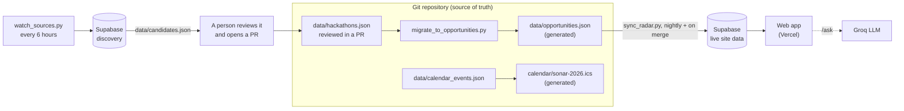

# SONAR

**A shared opportunity board for two people: hackathons, competitions, grants, fellowships and programmes, scored, sourced and counted down to the deadline.**

[](https://github.com/Sibusiso-K/SONAR/actions/workflows/ci.yml)
[](https://github.com/Sibusiso-K/SONAR/actions/workflows/codeql.yml)

Operators: **Sibusiso K** and **Lethabo**. Live board: `sonar-two-brown.vercel.app` (private; Vercel sign-in).

SONAR exists because a good opportunity is lost the day nobody is watching for it. It keeps one verified list, ranks it with an explicit formula, says honestly how sure it is of every date, and watches for the next one.

## How it works



Nothing reaches the published board without passing through a reviewed diff. The scraping pipeline only ever proposes; a person decides. More in [docs/ARCHITECTURE.md](docs/ARCHITECTURE.md).

## Quick start

You need Python 3.10+ and [Bun](https://bun.sh) 1.4+. The scripts use only the Python standard library.

```bash
git clone https://github.com/Sibusiso-K/SONAR && cd SONAR
make install        # dev tools (ruff, pytest) and the web app's dependencies
make check          # lint, type-check, unit and data tests (~15s)

python3 scripts/sonar.py next      # what closes soonest
python3 scripts/sonar.py list      # the full ranked board
```

Run the site locally against your own Supabase project, or against the test fixtures:

```bash
cd web
cp .env.example .env               # then fill in the VITE_SUPABASE_* values
bun run dev                        # http://localhost:8080

make e2e                           # browser tests; no database needed
```

`make help` lists every task.

## What is in the repo

| Path | What it is |
|---|---|
| `data/hackathons.json` | **The source of truth.** Every opportunity, its scores, dates and confidence. Edit this, then run `make data`. |
| `data/opportunities.json`, `calendar/*.ics` | Generated from the above. CI fails if they are stale. |
| `schema/` | JSON Schema for an entry. New entries must validate. |
| `scripts/` | The pipeline: CLI, migration, sync to the live database, source watcher, forecaster, smoke test. Standard library only. |
| `web/` | The site: TanStack Start + React 19, Tailwind 4, Supabase client, deployed on Vercel. |
| `supabase/`, `web/supabase/` | Database migrations for the discovery project and the live-site project. |
| `tests/`, `web/e2e/`, `web/src/**/*.test.ts` | Python tests, browser tests, unit tests. See [docs/TESTING.md](docs/TESTING.md). |
| `.github/workflows/` | CI, CodeQL, nightly board refresh, source watcher, migrations, post-deploy smoke test. |
| `docs/` | Everything else. Start at [docs/README.md](docs/README.md). |

## Adding an opportunity

1. Find it on the **organiser's own page**. Do not copy tracking parameters (`utm_*`, `fbclid`) into links.
2. Score it: `python3 scripts/sonar.py score --career 8 --win 6 --prize 7 --urgency 9`.
3. Add the entry to `data/hackathons.json` (copy a recent one), set `kind`, and set `dates.confidence` honestly: `confirmed`, `reported` or `unconfirmed`.
4. Add the source to `docs/SOURCES.md`.
5. `make data && make check`, then open a pull request.

The full rules, the schema and the scoring weights are in [CONTRIBUTING.md](CONTRIBUTING.md). How the board is ranked and the standing weekly rhythm are in [docs/OPERATING_GUIDE.md](docs/OPERATING_GUIDE.md).

## Quality gates

Every pull request runs: Python lint and tests (including schema, calendar and generated-file freshness checks), web type-check, lint, unit tests and build, browser end-to-end tests on desktop and mobile viewports, `bandit`, `bun audit`, and CodeQL. A smoke test probes the deployed site after each production deploy.

## Security

The site's public database key can only read the board. Writes belong to CI. Responses carry security headers, the assistant endpoint is rate-limited, and data-driven links are restricted to `http(s)`. To report a vulnerability, see [SECURITY.md](SECURITY.md). The model and the review are in [docs/SECURITY_REVIEW_2026-11-09.md](docs/SECURITY_REVIEW_2026-11-09.md).

## When something breaks

[docs/RUNBOOK.md](docs/RUNBOOK.md): the board is stale, the nightly refresh is red, a deploy needs rolling back, a migration needs applying, a key needs rotating.

## Copyright

All rights reserved. No licence is granted; see [COPYRIGHT.md](COPYRIGHT.md).
